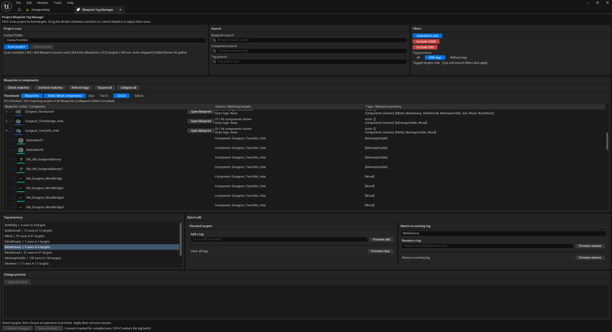

# Blueprint Tag Manager 1.0.6



A project-wide Unreal Engine editor tool for **Actor Tags** and **Component Tags**, targeting **UE 5.0 through 5.8**. Manage Actor Blueprints from the **main editor**, without opening each Blueprint asset.

**Platform:** Windows x64. Source compatibility targets UE 5.0-5.8; actual build and test results are listed by engine version in the [validation record](BlueprintTagManager/VALIDATION.md). Untested versions are identified explicitly. macOS and Linux are not supported. The UI is in English.

**Verified engine builds:** UE **5.3.2**, **5.5.4**, and **5.7.4**. One unified Windows ZIP includes these three prebuilt profiles and common source for the full target range. The other versions have not been executed or verified.

[User guide](BlueprintTagManager/README.md)

## Project-wide workflow

1. Open **Tools > Blueprint Tag Manager**, **Window > Blueprint Tag Manager**, or the main toolbar's **Blueprint Tags** button.
2. Opening the panel does not scan or load Blueprint assets. In **Project scan**, leave the folder blank for `/Game` and enabled project plugins with content, or enter a subfolder such as `/Game/Characters`. Click **Scan project** to start loading targets.
3. Assets are loaded sequentially to read their defaults. Progress, skipped non-Actor Blueprints, and failed assets are shown. **Cancel scan** leaves clearly marked partial results. Individual asset loads can still take time on large projects. Loaded Blueprints are kept in memory while the panel uses them.
4. Each Blueprint starts **collapsed**, with its Actor Tags, combined component tags, and matching/total component counts summarized on one row. Click its **name or arrow** to expand/collapse the list. The separate **Open Blueprint** button opens the asset; hover for its full path. **Actor Tags** are distinguished by bold text using the normal text color and background. **Expand all / Collapse all** changes the presentation.
5. **StaticMesh only** is **on by default**. Component rows are limited to `StaticMeshComponent` and derived types, including ISM/HISM, using their real class regardless of name or assigned mesh asset. **Exclude HISM** and **Exclude ISM** sit below it and work independently, whether StaticMesh only is on or off. Both exclusions default to off and turn **red** when enabled. HISM controls hierarchical instanced components; ISM controls non-hierarchical instanced components. Actor Tags remain a separate target. All filters combine, and excluded components are excluded from batch editing and inventory. **Components (shown)** summarizes tags only from components matching the current filters, including collapsed children. The total component count still covers the whole Blueprint.
6. In **Search**, use separate **Blueprint search** (name/path), **Component search** (component name), and **Tag search** (actual tag values). All nonempty fields must match; space-separated terms within each field must all match, case-insensitively. A component-name query excludes the Actor Tags row. The Source column identifies the local Blueprint, inherited Blueprint, or native C++ component class. In **Filters**, **Tag presence: All** includes all tags subject to the type/text filters. **With tags** shows only tagged targets in Blueprints with tags. **Without tags** retains each Blueprint's Actor Tags row regardless of actor tag presence, and shows only untagged components. A Blueprint whose actor and all components have tags is marked **All targets have tags**. Other filters still apply. Component summaries follow the displayed component list; Actor tag presence is reported as **Present / None**, independently of search matching.
7. Check individual targets, a Blueprint's group checkbox, or **Check matches / Uncheck matches**. New targets start unchecked. Group checkboxes select matching editable targets and show partial selection. Batch edits and inventory include **matching targets inside collapsed groups**; checked targets excluded by a search or component filter are excluded from the batch. Expanding/collapsing does not change the batch scope. Review the selected count and preview before applying.
8. In **Batch edit**, **Tag to add** sits beside **Preview add** in its own **Add a tag** block. **Preview clear** has a separate, input-free block. Under **Match an existing tag**, **Existing tag** is shared by Rename and Remove; click an inventory tag to fill it. **Replacement tag** sits beside **Preview rename** in the **Rename a tag** block, while **Preview remove** is separate below. Each input is visually grouped with the action that uses it.
9. Review the per-asset before/after list and click **Apply preview**. The whole batch is validated before tag writes. A stale preview rejects the batch. Parent/child assets can be edited together; inherited components get overrides in each selected Blueprint. One **Ctrl+Z** undoes the entire tag batch.
10. Use **Compile changed**, then **Save changed...** to compile and save the assets edited in this panel session. Compilation is cancellable; save uses Unreal's checkout/save dialog. Applying a preview does not save automatically. Closing the panel keeps the editor's unsaved changes; the normal editor Save All is also available.

**Refresh tags** re-reads loaded results after external changes; **Scan project** discovers newly added, renamed, or removed assets. Compile, Undo/Redo, and property changes trigger a refresh. Editing is disabled during Play/Simulate.

The panel separates **Project scan**, **Search**, **Filters**, **Blueprints & components**, **Tag inventory**, **Batch edit**, and **Change preview** with labeled sections. The four main rows default to approximately **16% / 47% / 21% / 16%**, giving more height to the Blueprint list. Horizontal proportions are unchanged. Drag the dividers to resize section heights and widths, or table headers to resize columns. Reduced control sections can be scrolled; adjustments remain in the current panel session.

The list toolbar separates **Selection** from **List controls**. **Check matches**, **Uncheck matches**, and the current checked/matching counts sit together; **Blueprints with checks** counts selected assets. Refresh/expand/collapse sit in their own group. **Thumbnails** has a separate heading, with **Show** switches and an **Image size** group below it.

**Project scan > Recent folders** stores the five most recent unique content folder paths confirmed with **Enter** or by starting **Scan project** with a valid scope, newest first. Click a path button to fill **Content folder**, then scan when ready; selecting a history entry does not start a scan. The **X** on its right removes it without clearing the current input. Blank scope and invalid/out-of-project paths are not stored. History survives panel/editor restarts in the project's local editor user settings under **Saved/Config**, which are excluded from Git and release archives.

In **Blueprints & components > Thumbnails**, independently toggle **Blueprints** and **Static Mesh components**. Both default to **off**; enable either or both. Blueprint group rows show the Blueprint asset thumbnail. Component rows show their effective assigned Static Mesh asset, including ISM, HISM, inherited overrides, and native components. Unassigned meshes and other component types show **No image** when component thumbnails are enabled; Actor Tags keep their normal text row. Choose **16x16**, **32x32** (default), or **64x64** for both types. Display settings remain in the current panel session and preserve filters, checks, expansion, and edit previews. Thumbnails are requested only for visible rows when enabled; real-time hover rendering is disabled.

## Install a release ZIP

Download **BlueprintTagManager-1.0.6-UE5.0-5.8-Win64.zip** and extract it. Close the project's Unreal Editor, then run this command from the extracted folder, substituting your own project and engine paths:

```powershell
powershell -NoProfile -ExecutionPolicy Bypass -File .\Scripts\Install-BlueprintTagManager.ps1 -ProjectFile 'D:\Projects\MyGame\MyGame.uproject' -EngineRoot 'C:\Program Files\Epic Games\UE_5.3'
```

The installer reads the selected engine's version and installs into `<YourProject>/Plugins/BlueprintTagManager`. For UE 5.3, 5.5, and 5.7, it selects the bundled prebuilt profile **only if its module Build ID matches the installed engine**. These matching profiles need no local compilation. For UE 5.0, 5.1, 5.2, 5.4, 5.6, 5.8, or a different/custom engine Build ID, it builds the common source using that engine. **Source fallback requires Visual Studio C++ tools and a Windows SDK supported by that engine.** Those six engine versions remain unverified; one download does not mean all nine versions have been tested. No engine or compiler is downloaded by the installer.

When upgrading, add **-Replace**. The previous plugin folder is moved to `<YourProject>/Saved/BlueprintTagManager/Backups/<timestamp>/BlueprintTagManager` before installation; a failed final move attempts to restore it. Existing installations are refused without this option. Backups stay outside Plugins so Unreal does not discover duplicate plugins. Enable **Edit > Plugins > Blueprint Tag Manager** and restart if requested. The installer does not edit the project file.

Use **-BuildFromSource** to bypass prebuilt profiles. Pass **-CompilerVersion** to select a toolset for a source fallback, or **-BuildOutputDirectory** to choose a fresh, short ASCII build path. The compiler option does not change prebuilt selection. For example, a UE 5.3 source build can select an installed MSVC 14.38 toolset with `-BuildFromSource -CompilerVersion '14.38.33130'`.

The ZIP contains a common **BlueprintTagManager** source folder, **Prebuilt/UE5.3**, **Prebuilt/UE5.5**, **Prebuilt/UE5.7**, and **Scripts**. Prebuilt profiles contain only the versioned descriptor, DLL, and module manifest. Use the installer to combine a matching profile with the common source. Copying only the common source folder does not install a prebuilt DLL.

Each DLL is built for one engine version; a UE 5.7 DLL cannot be reused as a universal UE 5.0-5.8 binary. Patches and custom engine builds can also require recompilation. See [Epic's module versioning documentation](https://dev.epicgames.com/documentation/en-us/unreal-engine/versioning-of-assets-and-packages-in-unreal-engine#buildid).

GitHub's **Code > Download ZIP** and automatic **Source code (zip)** downloads contain source without the release ZIP's Prebuilt profiles. The same installer builds source when profiles are absent, or use the build command below and copy its completed plugin folder into your project's Plugins folder. The common source descriptor is not pinned to 5.7; built binary descriptors record the engine minor version they were built for.

## Build source

Install your chosen UE version from **5.0 through 5.8**, plus Visual Studio with **Game development with C++**, an MSVC toolset supported by that engine, and Windows SDK. Keep `Scripts` beside `BlueprintTagManager`, then run from the repository or extracted source root:

```powershell
powershell -NoProfile -ExecutionPolicy Bypass -File .\Scripts\Build-BlueprintTagManager.ps1 -EngineRoot 'C:\Program Files\Epic Games\UE_5.7' -RunTests
```

Set `-EngineRoot` to your engine installation. The script creates a fresh disposable HostProject and prints the built plugin and checked release ZIP locations. `-OutputDirectory` must be a fresh, short ASCII path, at most 100 characters. The default is a new `BTM-<timestamp>` folder in the system temporary directory.

The engine version is read from that installation's `Engine/Build/Build.version`. ZIP names and the built descriptor use that version automatically. Bundled .NET layouts used by older and newer UE5 releases are supported. If necessary, select an installed toolset with `-CompilerVersion '14.38.33130'`; installing that toolset is a separate step. The latest MSVC toolset is not always suitable for an older engine.

The plugin includes a guarded non-Clang feature-test fallback for MSVC to handle older engine headers without editing the engine installation. The plugin module compiles without PCH or Unity; the engine's own precompiled build layout is left intact. Binary descriptors use the engine minor-version baseline (for example, 5.5.0 for a 5.5.4 build), while the module manifest retains the real build's Build ID.

To build and test the installed engines in the 5.0-5.8 range:

```powershell
powershell -NoProfile -ExecutionPolicy Bypass -File .\Scripts\Build-EngineMatrix.ps1 -OutputDirectory 'C:\UEBuild\BTM-Matrix' -RunTests
```

The matrix discovers standard Epic installations and Launcher-registered paths. Use `-EngineRoots` for custom locations, `-MinorVersions` for a subset, or `-CompilerVersions` to choose a toolset per engine. It creates separate HostProjects, binaries, tests, and archives for each engine and writes `CompatibilityResults.json`. Missing engines are marked **NotInstalled**, never passed. Add `-RequireAllVersions` to reject missing engines before starting any builds. Neither script downloads engines or changes their source.

To assemble one distribution after building, run `Scripts/New-UnifiedRelease.ps1` with **-BuiltPluginDirectories** containing each completed `HostProject/Plugins/BlueprintTagManager` path and **-OutputZip** naming the destination ZIP. It checks that all profiles were built from the common source, packages the installer and profiles, scans the result, and writes a SHA-256 sidecar. It does not build missing engines.

## Scope and limits

- Actor Blueprints, local components, inherited Blueprint components, and native C++ default components are supported, including untagged components. Non-Actor Blueprints such as Widgets, Animation Blueprints, and Component Blueprints do not have actor/component defaults of their own for this tool to edit and are counted as skipped.
- Engine content is outside the project editing scope. The main results include current effective inherited tags; editing a child uses its own override. A parent asset is changed only when its own targets are included in the batch. Normal Unreal inheritance can affect descendants that have no overrides.
- Gameplay Tags, dynamically created components, tags overwritten by Construction Script/gameplay code, and level-instance overrides are outside this tool's scope. Child Actor Component tags are included; the spawned child actor's own Blueprint appears separately if it is in the scan scope.
- FName matching is case-insensitive. Case-only renames are no-ops. Empty/None tag inputs are rejected. Read-only inherited components are displayed but cannot be checked.
- The plugin has no network service, account, telemetry, or third-party plugin dependency. Unreal Engine and its tools can have their own network behavior.

## Feedback and contributions

For bug reports, include your Unreal Engine version, Windows version, steps to reproduce the issue, and the expected and actual behavior. A minimal reproduction project or relevant log excerpt can help explain the problem.

For feature requests, describe the task you want to accomplish and how the proposed feature would improve that workflow.

When submitting a code change, explain its purpose and include validation results. Use the source build command above with `-RunTests` to run the plugin's automation tests.

## License

Original code and scripts use the [MIT License](LICENSE); a copy is included in the plugin folder. Unreal Engine remains a separate dependency under [Epic's Unreal Engine license](https://www.unrealengine.com/eula/unreal). The engine SDK is not included.
